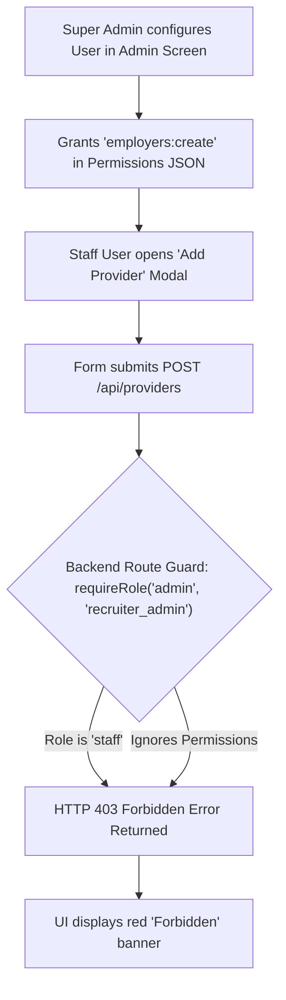
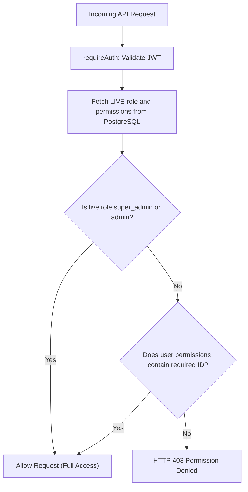

# Role and Permission Architecture Plan

## 1. Executive Summary

### 1.1 Context and Problem Statement
A staff member attempted to add a provider record ("AKG Richmond") within the ATS and received an **HTTP 403 Forbidden** error banner, despite the Super Admin having explicitly granted operational permissions in the platform.

Subsequent review clarified the client's mandatory role structure:
1. **Super Admin**: System governance, user administration, and permission assignment.
2. **Admin**: Full access across the platform.
3. **Staff**: Granular access determined by Super Admin permissions.
4. **HR**: Granular access determined by Super Admin permissions.
5. **Marketing**: Granular access determined by Super Admin permissions.

Four legacy roles present in the legacy codebase are no longer approved:
- `recruiter_admin` (Remove)
- `recruiter` (Remove)
- `training_admin` (Remove)
- `hiring_manager` (Remove)

Three active users in the database currently hold the legacy `recruiter_admin` role:
- **Andy** (`andy@workvision.com.au`)
- **Harry** (`harry@workvision.com.au`)
- **Talia** (`talia@workvision.com.au`)

The client confirmed that Andy, Harry, and Talia must be migrated to the **`staff`** role with their operational permissions preserved.

---

## 2. Root Cause Analysis

### 2.1 The Forbidden Error Mechanism
The system exhibits an architectural disconnect between permission storage and API authorization:



### 2.2 Why Hardcoding Role Names Fails (Routes and SQL Queries)
Hardcoding static role names across the application creates cascading failures:
1. **Route Guards Break on Role Transitions**: If a user is moved from `Staff` to `Marketing` or `HR`, hardcoded checks fail.
2. **Bypasses Real-Time Admin Control**: When Super Admin ticks or unticks a box, a hardcoded role guard ignores the change completely.
3. **SQL Queries Exclude Active Team Members**: Queries containing `WHERE u.role IN ('admin', 'recruiter_admin', 'recruiter')` exclude staff from placement KPI boards and analytics.
4. **Stale JWT Payloads Block Live Updates**: If authorization middleware only reads `req.user.role` from the login JWT token, Super Admin changes do not take effect until the user logs out and logs back in.

---

## 3. Database Constraints Analysis & Recommendation

### 3.1 Why the Hardcoded SQL Check Constraint Is an Anti-Pattern
The database currently enforces a hardcoded PostgreSQL check constraint on the `users` table:
```sql
CHECK (role IN ('admin', 'recruiter_admin', 'recruiter', 'staff', 'hiring_manager', 'provider', 'training_admin'))
```

This constraint was originally added to prevent arbitrary typos in the role column, but in practice it introduced severe architectural liabilities:
1. **Silent Production Breakages**: When new business roles (`hr`, `marketing`) were added to the application, the database constraint was not updated. Any attempt to save a user with role `hr` or `marketing` crashes with a PostgreSQL constraint violation error.
2. **Rigidity and DDL Migration Overhead**: Any change in business roles requires running raw DDL migrations (`ALTER TABLE users DROP CONSTRAINT ... ADD CONSTRAINT ...`) against the production database.
3. **Violates Separation of Concerns**: Application authorization rules and business roles belong in the application configuration layer, not locked into hardcoded database check constraints.

### 3.2 Recommendation: Drop the Database Constraint and Validate in the Application Layer
The recommended architectural approach is:
- **Drop the `users_role_check` constraint entirely from PostgreSQL.**
- **Set the column default to `'staff'` instead of legacy `'recruiter'`.**
- **Enforce role validation strictly at the application boundary (Backend API).**

#### Implementation Details:
1. **Database Migration**:
   ```sql
   -- Drop the fragile hardcoded constraint permanently
   ALTER TABLE users DROP CONSTRAINT IF EXISTS users_role_check;

   -- Update default value to 'staff'
   ALTER TABLE users ALTER COLUMN role SET DEFAULT 'staff';
   ```
2. **Backend Application Validation** (`packages/backend/src/routes/users.js`):
   ```javascript
   export const ALLOWED_ROLES = [
     "super_admin",
     "admin",
     "staff",
     "hr",
     "marketing"
   ];

   function validateRole(role) {
     if (!ALLOWED_ROLES.includes(role)) {
       throw new Error(`Invalid role '${role}'. Allowed roles: ${ALLOWED_ROLES.join(", ")}`);
     }
   }
   ```

---

## 4. Target Role & Authorization Architecture

### 4.1 Role Model Matrix

| Role | Role Key | Access Model | Permissions Customization |
|---|---|---|---|
| **Super Admin** | `super_admin` | Unrestricted Root Access | Bypasses all permission checks (26/26 granted) |
| **Admin** | `admin` | Full Operational Access | Bypasses all permission checks (26/26 granted) |
| **Staff** | `staff` | Custom Configurable | Super Admin checks/unchecks individual permissions |
| **HR** | `hr` | Custom Configurable | Super Admin checks/unchecks individual permissions |
| **Marketing** | `marketing` | Custom Configurable | Super Admin checks/unchecks individual permissions |

### 4.2 Real-Time Authorization Enforcement (No Re-login Required)
To ensure role and permission updates apply immediately on the user's very next click:



```javascript
// packages/backend/src/middleware/auth.js
export function requirePermission(...requiredPermissions) {
  return async (req, res, next) => {
    try {
      const { pool } = await import("../config/db.js");
      const { rows } = await pool.query(
        "SELECT role, permissions FROM users WHERE id = $1",
        [req.user.id]
      );
      if (!rows[0]) return res.status(403).json({ success: false, error: "Forbidden" });

      const liveRole = rows[0].role;
      const livePerms = rows[0].permissions || [];

      // Super Admin and Admin bypass all checks
      if (liveRole === "super_admin" || liveRole === "admin") return next();

      // Check required permission
      const hasAll = requiredPermissions.every((p) => livePerms.includes(p));
      if (!hasAll) {
        return res.status(403).json({
          success: false,
          error: `Permission denied. Required: ${requiredPermissions.join(", ")}`,
        });
      }
      next();
    } catch (err) {
      next(err);
    }
  };
}
```

---

## 5. Elimination of Hardcoded Roles in SQL Queries

### 5.1 Placements Leaderboard & KPIs (`stats.js`)
- **Current Anti-Pattern**:
  ```sql
  -- OLD: Hardcoded role filter
  SELECT u.id, u.name, COUNT(p.id)::int AS total_placements
  FROM users u
  LEFT JOIN placements p ON p.created_by = u.id
  WHERE u.role IN ('admin', 'recruiter_admin', 'recruiter')
  ```
- **New Role-Agnostic Solution**:
  Eliminate `WHERE u.role IN (...)`. Any internal team member who has created a placement is automatically included on the leaderboard based on actual activity:
  ```sql
  -- NEW: Activity-based join (role-agnostic)
  SELECT u.id, u.name, COUNT(p.id)::int AS total_placements
  FROM users u
  JOIN placements p ON p.created_by = u.id
  ```

### 5.2 Recruiter Activity Reports (`reports.js`)
- **Current Anti-Pattern**:
  ```sql
  -- OLD: Hardcoded role filter
  WHERE u.role IN ('admin', 'recruiter_admin', 'recruiter')
  ```
- **New Role-Agnostic Solution**:
  Join directly on `job_recruiter jr ON jr.user_id = u.id`. Anyone assigned to manage jobs is included based on their job assignments, without role hardcoding.

### 5.3 Job Vacancy Recruiter Assignment (`jobs.js`)
- **Current Anti-Pattern**:
  ```sql
  -- OLD: Hardcoded role filter
  SELECT id FROM users WHERE id = ANY($1::uuid[]) AND role IN ('recruiter', 'recruiter_admin')
  ```
- **New Role-Agnostic Solution**:
  Validate that assigned user IDs belong to valid platform team members:
  ```sql
  -- NEW: Validates user exists in users table
  SELECT id FROM users WHERE id = ANY($1::uuid[])
  ```

---

## 6. User Migration Plan (Andy, Harry, Talia)

### 6.1 Migration Query
Migrate Andy, Harry, and Talia from `recruiter_admin` to `staff` while preserving their exact operational permissions:

```sql
UPDATE users
SET role = 'staff',
    updated_at = NOW()
WHERE email IN (
  'andy@workvision.com.au',
  'harry@workvision.com.au',
  'talia@workvision.com.au'
);
```

### 6.2 Permissions Retained
- **Andy**: 17 permissions (Employers/Providers, Vacancies, Candidates, Placements, Training view, Reports)
- **Harry**: 17 permissions (Employers/Providers, Vacancies, Candidates, Placements, Training view, Reports)
- **Talia**: 14 permissions (Employers/Providers, Vacancies, Placements, Training view, Reports)

Because their permissions array already contains `employers:create` and `employers:edit`, they will continue to create and manage providers seamlessly.

---

## 7. Backend Route Guard Alignment Plan

### 7.1 Route Guard Standardization
Replace hardcoded role guards with `requirePermission(...)`:

| File | Current Route Guard | Proposed Route Guard |
|---|---|---|
| `packages/backend/src/routes/providers.js` | `requireRole('admin', 'recruiter_admin')` on POST, PUT | `requirePermission('employers:create')`, `requirePermission('employers:edit')` |
| `packages/backend/src/routes/providers.js` | `requireRole('admin', 'recruiter_admin')` on OneDrive sheets & sync | `requirePermission('employers:edit')` |
| `packages/backend/src/routes/ms-auth.js` | `requireRole('admin', 'recruiter_admin')` on connect/disconnect | `requirePermission('employers:edit')` |
| `packages/backend/src/routes/master.js` | `requireRole('admin', 'recruiter_admin')` | `requirePermission('admin:master_data')` |
| `packages/backend/src/routes/departments.js` | `requireRole('admin', 'recruiter_admin')` | `requirePermission('employers:edit')` |
| `packages/backend/src/routes/locations.js` | `requireRole('admin', 'recruiter_admin')` | `requirePermission('employers:edit')` |
| `packages/backend/src/routes/trainings.js` | `requireRole('admin', 'recruiter_admin')` | `requirePermission('training:manage')` |
| `packages/backend/src/routes/candidate-trainings.js` | `requireRole('admin', 'recruiter_admin', 'recruiter')` | `requirePermission('training:enroll')` |
| `packages/backend/src/routes/placements.js` | `requireRole('admin', 'recruiter_admin', 'recruiter')` | `requirePermission('placements:create')` / `requirePermission('placements:confirm')` |

### 7.2 Remove Obsolete `training_admin` Blocks
Remove legacy manual role checks from `applications.js`, `employers.js`, `jobs.js`, `placements.js`, and `providers.js`:
```javascript
// Remove this obsolete block
if (req.user.role === "training_admin") {
  return res.status(403).json({ success: false, error: "Access denied for Training Admin" });
}
```

### 7.3 Permissions Catalog & Presets (`packages/backend/src/config/permissions.js`)
- Retain presets only for `super_admin`, `admin`, `staff`, `hr`, and `marketing`.
- Remove definitions for `recruiter_admin`, `recruiter`, `training_admin`, and `hiring_manager`.

---

## 8. Frontend UI Adjustments

### 8.1 TypeScript Types (`packages/frontend/src/types/index.ts`)
Update the `UserRole` union:
```typescript
export type UserRole = "super_admin" | "admin" | "staff" | "hr" | "marketing";
```

### 8.2 User Management Page (`packages/frontend/src/pages/AdminUsers.tsx`)
1. **Filter and Edit Dropdown**:
   Update `ROLES` array to contain only the 5 approved roles:
   - Super Admin
   - Admin
   - Staff
   - HR
   - Marketing
2. **Permission Column Display**:
   - For `super_admin` and `admin`: Displays `Full Access (26/26)` badge.
   - For `staff`, `hr`, `marketing`: Displays clickable button `{count} / 26 granted`. Clicking opens the permissions configuration modal.

### 8.3 Create User Dialog (`packages/frontend/src/components/CreateUserDialog.tsx`)
- Update role selector to show only the 5 approved roles.
- Change default role from `recruiter` to `staff`.

### 8.4 Providers Page UI Guard (`packages/frontend/src/pages/Providers.tsx`)
Replace hardcoded role checks with permission-based checks:
```tsx
// Replace:
const isAdmin = user?.role === "super_admin" || user?.role === "admin" || user?.role === "recruiter_admin";

// With:
const { hasPermission } = usePermissions();
const canCreate = hasPermission("employers:create");
```

---

## 9. Verification and Testing Checklist

- [ ] **Database Constraint Drop**: Verify `users_role_check` constraint is successfully dropped from table `users`.
- [ ] **Database Default Value**: Verify `users.role` column default is `'staff'`.
- [ ] **User Migration Verification**: Confirm Andy, Harry, and Talia have `role = 'staff'` and retain their permission sets.
- [ ] **Real-Time Live Permission Test**: Change a permission for a staff member and verify that their very next API request immediately uses the updated permission without re-login.
- [ ] **Provider Creation Test (Permitted Staff)**: Authenticate as a staff user with `employers:create` granted and submit `POST /api/providers`. Verify HTTP 201 Created without 403 Forbidden.
- [ ] **Negative Permission Test (Denied Staff)**: Revoke `employers:create` from a staff user and verify that submitting `POST /api/providers` cleanly returns HTTP 403 Permission Denied.
- [ ] **OneDrive & Spreadsheet Sync Test**: Authenticate as a staff user with `employers:edit` and verify OneDrive sheet browsing and sync work.
- [ ] **Leaderboard / Report Test**: Verify placements created by Andy, Harry, and Talia appear correctly on dashboard KPI boards without being filtered out.
- [ ] **User Management UI Test**: Confirm that the "Add User" dialog and inline edit dropdowns display only the 5 target roles.
